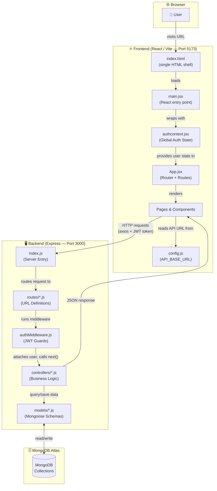
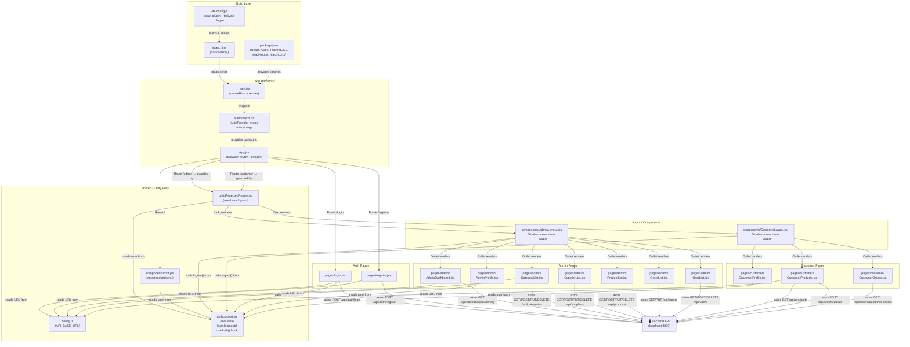
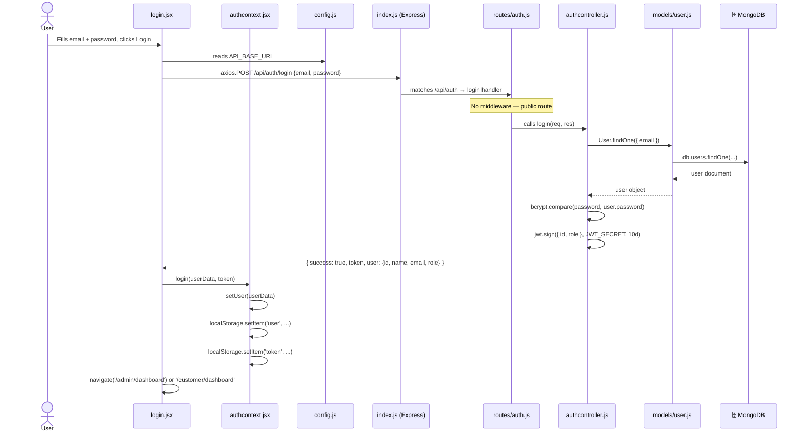
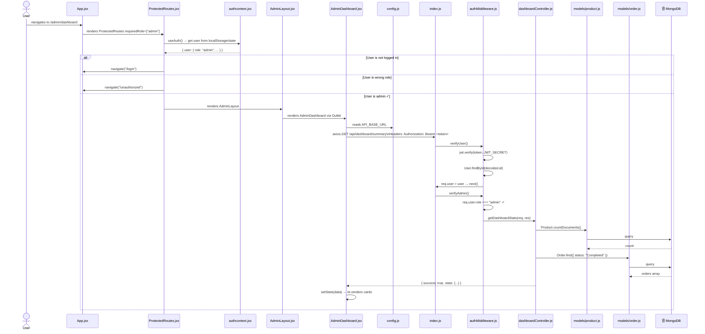
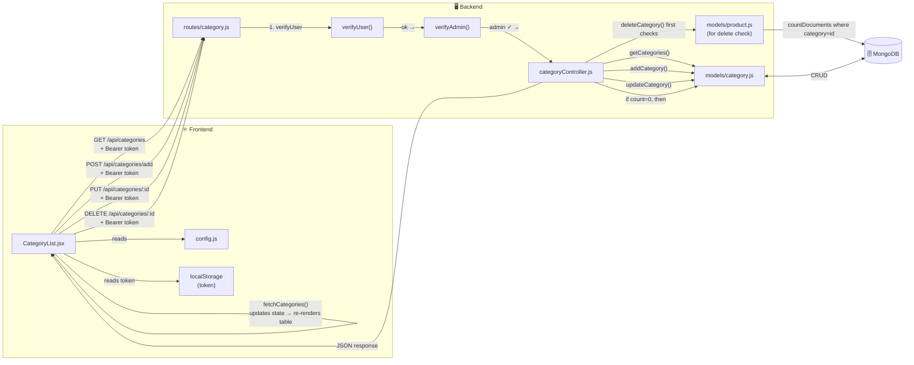
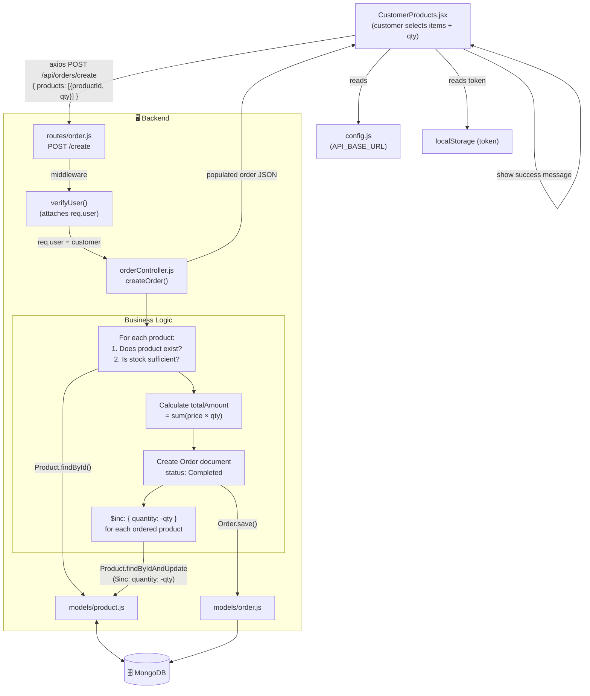
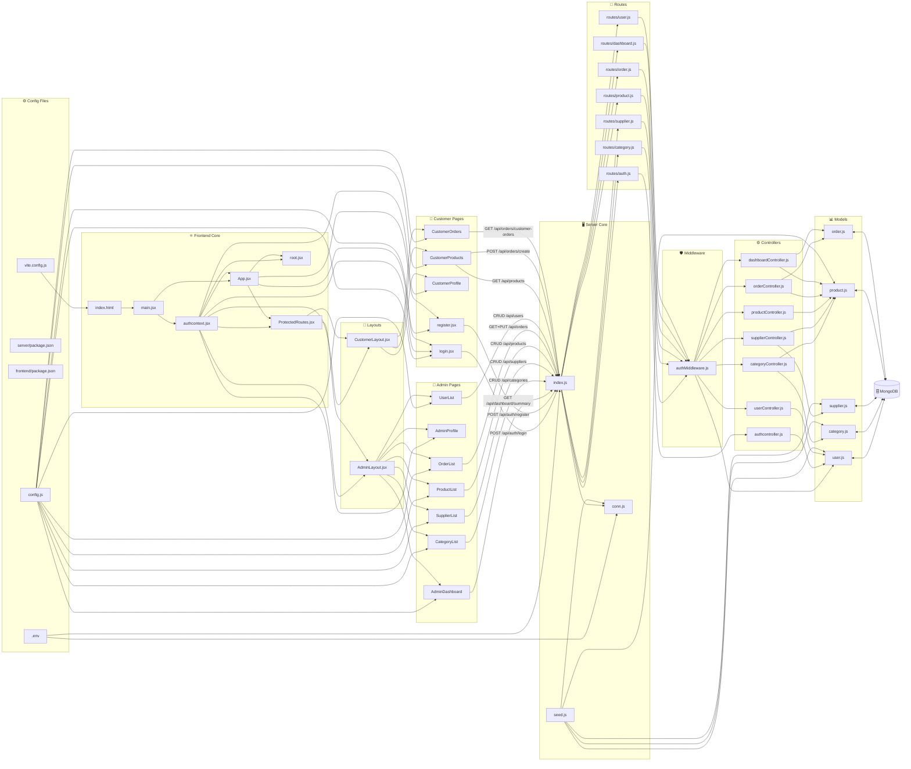

# 🗺️ File Communication Flowcharts — Inventory Management System

---

## 📌 Diagram 1 — Overall Architecture (Big Picture)

---

## 📌 Diagram 2 — Backend File Communication

```mermaid
flowchart TD
    ENV[".env\n(PORT, MONGODB_URI, JWT_SECRET)"]
    PKG["package.json\n(dependencies + scripts)"]

    subgraph ENTRY["Entry Layer"]
        IDX["index.js\n(Express app setup)"]
        CONN["connection.js/conn.js\n(mongoose.connect)"]
    end

    subgraph ROUTES["Routes Layer\n(URL → Handler mapping)"]
        R_AUTH["routes/auth.js\nPOST /login\nPOST /register"]
        R_CAT["routes/category.js\nGET / POST /add\nPUT /:id DELETE /:id"]
        R_PROD["routes/product.js\nGET / GET /:id\nPOST /add PUT /:id DELETE /:id"]
        R_SUP["routes/supplier.js\nGET / POST /add\nPUT /:id DELETE /:id"]
        R_ORD["routes/order.js\nPOST /create\nGET / GET /customer-orders\nPUT /:id/status"]
        R_DASH["routes/dashboard.js\nGET /summary"]
        R_USR["routes/user.js\nGET / POST /add DELETE /:id"]
    end

    subgraph MW["Middleware Layer"]
        VU["verifyUser()\n(decode JWT → attach req.user)"]
        VA["verifyAdmin()\n(check role === admin)"]
    end

    subgraph CTRL["Controller Layer\n(Business Logic)"]
        C_AUTH["authcontroller.js\nlogin() register()"]
        C_CAT["categoryController.js\naddCategory() getCategories()\nupdateCategory() deleteCategory()"]
        C_PROD["productController.js\naddProduct() getProducts()\ngetProductById() updateProduct()\ndeleteProduct()"]
        C_SUP["supplierController.js\naddSupplier() getSuppliers()\nupdateSupplier() deleteSupplier()"]
        C_ORD["orderController.js\ncreateOrder() getOrders()\ngetCustomerOrders() updateOrderStatus()"]
        C_DASH["dashboardController.js\ngetDashboardStats()"]
        C_USR["userController.js\ngetUsers() addUser() deleteUser()"]
    end

    subgraph MODELS["Model Layer\n(Mongoose Schemas)"]
        M_USER["models/user.js\nUser Schema\nname, email, password,\naddress, role"]
        M_CAT["models/category.js\nCategory Schema\nname, description, createdAt"]
        M_PROD["models/product.js\nProduct Schema\nname, category→ref,\nsupplier→ref, price,\nquantity, image"]
        M_SUP["models/supplier.js\nSupplier Schema\nname, email, phone, address"]
        M_ORD["models/order.js\nOrder Schema\ncustomer→ref, products[],\ntotalAmount, status"]
    end

    DB[("🗄️ MongoDB Atlas")]
    SEED["seed.js\n(One-time DB populator)"]

    ENV -->|"process.env.*"| IDX
    ENV -->|"process.env.MONGODB_URI"| CONN
    PKG -->|"defines start script"| IDX

    IDX -->|"app.listen() then calls"| CONN
    IDX -->|"app.use('/api/auth')"| R_AUTH
    IDX -->|"app.use('/api/categories')"| R_CAT
    IDX -->|"app.use('/api/products')"| R_PROD
    IDX -->|"app.use('/api/suppliers')"| R_SUP
    IDX -->|"app.use('/api/orders')"| R_ORD
    IDX -->|"app.use('/api/dashboard')"| R_DASH
    IDX -->|"app.use('/api/users')"| R_USR

    R_AUTH -->|"no middleware needed"| C_AUTH
    R_CAT -->|"verifyUser"| VU
    R_CAT -->|"verifyAdmin (for write)"| VA
    R_PROD --> VU
    R_PROD --> VA
    R_SUP --> VU
    R_SUP --> VA
    R_ORD --> VU
    R_ORD --> VA
    R_DASH --> VU
    R_DASH --> VA
    R_USR --> VU
    R_USR --> VA

    VU -->|"reads JWT secret from"| ENV
    VU -->|"User.findById(decoded.id)"| M_USER
    VA -->|"checks req.user.role"| VU

    VU --> C_CAT
    VA --> C_CAT
    VU --> C_PROD
    VA --> C_PROD
    VU --> C_SUP
    VA --> C_SUP
    VU --> C_ORD
    VA --> C_ORD
    VU --> C_DASH
    VA --> C_DASH
    VU --> C_USR
    VA --> C_USR

    C_AUTH -->|"bcrypt + jwt"| M_USER
    C_CAT -->|"CRUD operations"| M_CAT
    C_CAT -->|"check if products exist"| M_PROD
    C_PROD -->|"CRUD operations"| M_PROD
    C_SUP -->|"CRUD operations"| M_SUP
    C_SUP -->|"check if products exist"| M_PROD
    C_ORD -->|"CRUD operations"| M_ORD
    C_ORD -->|"update stock quantity"| M_PROD
    C_ORD -->|"validate product"| M_PROD
    C_DASH -->|"count + aggregate"| M_PROD
    C_DASH -->|"count + aggregate"| M_ORD
    C_USR -->|"CRUD operations"| M_USER

    M_USER <-->|"mongoose CRUD"| DB
    M_CAT <-->|"mongoose CRUD"| DB
    M_PROD <-->|"mongoose CRUD"| DB
    M_SUP <-->|"mongoose CRUD"| DB
    M_ORD <-->|"mongoose CRUD"| DB

    SEED -->|"imports + calls connectDB"| CONN
    SEED -->|"creates test data"| M_USER
    SEED -->|"creates test data"| M_CAT
    SEED -->|"creates test data"| M_SUP
    SEED -->|"creates test data"| M_PROD
```

---

## 📌 Diagram 3 — Frontend File Communication

---

## 📌 Diagram 4 — Authentication Flow (Login Request)

---

## 📌 Diagram 5 — Protected Route + Data Fetch Flow

---

## 📌 Diagram 6 — CRUD Flow (Category Example)

---

## 📌 Diagram 7 — Order Placement Flow (Stock Management)

---

## 📌 Diagram 8 — Complete File Dependency Map

